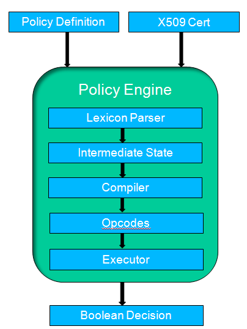

# Policy Engine Architecture

At its core, the policy engine is a boolean logic engine. It evaluates a set of rules — a [PolicyExpression](http://api.directproject.info/direct-policy/1.0/apidocs/org/nhindirect/policy/PolicyExpression.html) — against a given X.509 certificate and decides whether the certificate complies with the policy.

Structurally, the engine resembles a compiled programming language and its runtime. A policy begins life as a definition file written in a particular [PolicyLexicon](http://api.directproject.info/direct-policy/1.0/apidocs/org/nhindirect/policy/PolicyLexicon.html) (syntax). That definition is [parsed](http://api.directproject.info/direct-policy/1.0/apidocs/org/nhindirect/policy/PolicyLexiconParser.html) into an intermediate representation, [compiled](http://api.directproject.info/direct-policy/1.0/apidocs/org/nhindirect/policy/Compiler.html) into a set of [opcodes](http://api.directproject.info/direct-policy/1.0/apidocs/org/nhindirect/policy/Opcode.html) targeted at a specific [ExecutionEngine](http://api.directproject.info/direct-policy/1.0/apidocs/org/nhindirect/policy/ExecutionEngine.html), and finally executed by that engine to produce a result.

The following diagram is a modular view of the engine:



## Policy Definition

Policies are expressed in a boolean syntax in which attributes and extension values of an X.509 certificate are compared against supplied [literals](http://api.directproject.info/direct-policy/1.0/apidocs/org/nhindirect/policy/LiteralPolicyExpression.html). The engine provides a range of operators and supports compound and ternary expressions, making it a powerful and flexible way to assert conditions about a certificate.

A certificate extension can also be flagged as *required*. If a required extension is absent from the certificate, the certificate is automatically treated as non-compliant.

Every policy definition ultimately evaluates to a single boolean value: `true` means the certificate complies with the policy, and `false` means it does not.

All policies are written in a formal lexicon (syntax). The supported lexicons are enumerated in the `PolicyLexicon` class:

* [Serialized XML](http://api.directproject.info/direct-policy/1.0/apidocs/org/nhindirect/policy/impl/XMLLexiconPolicyParser.html) — An XML representation of the intermediate state.
* [Serialized Java Object](http://api.directproject.info/direct-policy/1.0/apidocs/org/nhindirect/policy/impl/JavaSerializedObjectLexiconPolicyParser.html) — A serialized Java object representation of the intermediate state.
* [Simple Text Version 1](http://api.directproject.info/direct-policy/1.0/apidocs/org/nhindirect/policy/impl/SimpleTextV1LexiconPolicyParser.html) — A simple syntax similar to writing an `if` statement. This is the lexicon most policy authors use; it is documented in full in the [Simple Text Lexicon](stext-lexicon) guide.

## Policy Lexicon Parser and Compiler

The engine turns a policy definition into executable operations (opcodes) in a two-pass process: parsing, then compiling.

### Parsing

A [PolicyLexiconParser](http://api.directproject.info/direct-policy/1.0/apidocs/org/nhindirect/policy/PolicyLexiconParser.html) translates a policy definition written in a supported lexicon into a common intermediate representation. The parser validates the syntax and throws a [PolicyParseException](http://api.directproject.info/direct-policy/1.0/apidocs/org/nhindirect/policy/PolicyParseException.html) if it finds any errors. Parse errors currently carry limited detail — for example, they do not yet report the line or character position of the error — but they aim to give you enough information to locate the cause.

When parsing succeeds, the parsed definition is stored as a [PolicyExpression](http://api.directproject.info/direct-policy/1.0/apidocs/org/nhindirect/policy/PolicyExpression.html) object, which is the intermediate representation. A parsed `PolicyExpression` is generally a tree, where each leaf node is either a literal or another operator [expression](http://api.directproject.info/direct-policy/1.0/apidocs/org/nhindirect/policy/OperationPolicyExpression.html). The root of a valid tree is always an operator that evaluates to a boolean value.

Intermediate `PolicyExpression` objects can be serialized to an external medium with the [PolicyExpressionSerializer](http://api.directproject.info/direct-policy/1.0/apidocs/org/nhindirect/policy/PolicyExpressionSerializer.html), which almost all `PolicyLexiconParser` implementations support.

Create parsers with the [PolicyLexiconParserFactory](http://api.directproject.info/direct-policy/1.0/apidocs/org/nhindirect/policy/PolicyLexiconParserFactory.html). The following example creates a parser and parses a definition into an intermediate-state object:

```
  final InputStream stream = IOUtils.toInputStream("X509.TBS.EXTENSION.SubjectKeyIdentifier+ = 1.3.2.3");

  final LexiconParser parser = PolicyLexiconParserFactory.getInstance(PolicyLexicon.SIMPLE_TEXT_V1);

  PolicyExpression expression = null;

  try
  {
     expression = parser.parse(stream);
  }
  catch (PolicyParseException e)
  {
    // handle the exception
  }
```

### Compiling

The [compiler](http://api.directproject.info/direct-policy/1.0/apidocs/org/nhindirect/policy/Compiler.html) is the second pass, run after a definition has been parsed into a [PolicyExpression](http://api.directproject.info/direct-policy/1.0/apidocs/org/nhindirect/policy/PolicyExpression.html) tree. It takes the parsed expression and a certificate and produces an ordered vector of [Opcode](http://api.directproject.info/direct-policy/1.0/apidocs/org/nhindirect/policy/Opcode.html) objects specific to a particular [ExecutionEngine](http://api.directproject.info/direct-policy/1.0/apidocs/org/nhindirect/policy/ExecutionEngine.html). If an error occurs during compilation, the compiler throws a [PolicyProcessException](http://api.directproject.info/direct-policy/1.0/apidocs/org/nhindirect/policy/PolicyProcessException.html).

For policy-expression tokens that resolve to [ReferencePolicyExpressions](http://api.directproject.info/direct-policy/1.0/apidocs/org/nhindirect/policy/ReferencePolicyExpression.html), the compiler extracts the corresponding attribute values from the certificate. (Each lexicon defines which tokens represent certificate attributes.)

By default, if a required attribute is missing from the certificate, the compiler throws a [PolicyRequiredException](http://api.directproject.info/direct-policy/1.0/apidocs/org/nhindirect/policy/PolicyRequiredException.html) and halts evaluation at the first missing field. In some cases, though — a policy validation tool, for instance — it is useful to collect a complete list of missing fields, or to run the certificate through the execution engine even when required fields are known to be missing. (This is not the most efficient mode when the only result of interest is the binary compliance decision.)

To collect all missing fields and other compilation errors instead of failing fast, enable *report mode* by calling [setReportModeEnabled](http://api.directproject.info/direct-policy/1.0/apidocs/org/nhindirect/policy/Compiler.html#setReportModeEnabledboolean). In report mode, the compiler no longer throws an exception for a missing required attribute. After compilation, retrieve the full collection of compilation issues with [getCompilationReport](http://api.directproject.info/direct-policy/1.0/apidocs/org/nhindirect/policy/Compiler.html#getCompilationReport).

Create a compiler by instantiating a concrete implementation directly. The following example extends the previous one: it compiles the parsed definition against a certificate using a [StackMachineCompiler](http://api.directproject.info/direct-policy/1.0/apidocs/org/nhindirect/policy/impl/machine/StackMachineCompiler.html), whose opcodes are executed by the [StackMachine](http://api.directproject.info/direct-policy/1.0/apidocs/org/nhindirect/policy/impl/machine/StackMachine.html) execution engine.

```
  final X509Certificate certToEvaluate = getCertificateToEvaluate();

  final InputStream stream = IOUtils.toInputStream("X509.TBS.EXTENSION.SubjectKeyIdentifier+ = 1.3.2.3");

  final LexiconParser parser = PolicyLexiconParserFactory.getInstance(PolicyLexicon.SIMPLE_TEXT_V1);

  final Compiler compiler = new StackMachineCompiler();

  Vector<Opcode> opcodes = null;

  PolicyExpression expression = null;

  try
  {
     expression = parser.parse(stream);

     opcodes = compiler.compile(certToEvaluate, expression);
  }
  catch (PolicyProcessException e)
  {
    // handle the exception
  }
```

### Execution Engine

The [ExecutionEngine](http://api.directproject.info/direct-policy/1.0/apidocs/org/nhindirect/policy/ExecutionEngine.html) is the final stage of policy evaluation. It runs an ordered vector of opcodes and produces a boolean result indicating whether the certificate supplied earlier complies with the policy definition. You can think of the execution engine as the runtime library of the policy engine.

Remember that the opcodes a compiler produces are targeted at a specific execution engine implementation. The reference implementation provides a default engine based on a stack machine: the [StackMachine](http://api.directproject.info/direct-policy/1.0/apidocs/org/nhindirect/policy/impl/machine/StackMachine.html) class implements the engine, and — as shown in the previous section — its opcodes are generated by the [StackMachineCompiler](http://api.directproject.info/direct-policy/1.0/apidocs/org/nhindirect/policy/impl/machine/StackMachineCompiler.html).

The execution engine exposes a single method, [evaluate](http://api.directproject.info/direct-policy/1.0/apidocs/org/nhindirect/policy/ExecutionEngine.html#evaluatejava.util.Vector). It takes the ordered vector of opcodes from the compiler and returns a boolean: `true` means the certificate supplied to the compiler complies with the policy definition, and `false` means it does not. Like the parser and compiler, the execution engine throws a [PolicyProcessException](http://api.directproject.info/direct-policy/1.0/apidocs/org/nhindirect/policy/PolicyProcessException.html) if an error occurs during execution.

```
  final X509Certificate certToEvaluate = getCertificateToEvaluate();

  final InputStream stream = IOUtils.toInputStream("X509.TBS.EXTENSION.SubjectKeyIdentifier+ = 1.3.2.3");

  final LexiconParser parser = PolicyLexiconParserFactory.getInstance(PolicyLexicon.SIMPLE_TEXT_V1);

  final Compiler compiler = new StackMachineCompiler();

  final ExecutionEngine engine = new StackMachine();

  Vector<Opcode> opcodes = null;

  PolicyExpression expression = null;

  try
  {
     expression = parser.parse(stream);

     opcodes = compiler.compile(certToEvaluate, expression);

     return engine.evaluate(opcodes);
  }
  catch (PolicyProcessException e)
  {
    // handle the exception
  }
```

### Policy Filter

The sections above break the policy engine into its individual parts and show how they fit together to decide whether a certificate complies with a policy. Using the components separately is valuable for tasks such as writing a policy editor or an external evaluation tool. But when you simply want to start with a definition and a certificate and get a compliance decision, the three-phase flow is almost always the same. The [PolicyFilter](http://api.directproject.info/direct-policy/1.0/apidocs/org/nhindirect/policy/PolicyFilter.html) packages that flow into a single construct.

Policy filters are the central construct of the policy engine: they determine whether an X.509 certificate complies with a given policy. Internally, a filter encapsulates the modular pieces of the engine — parser, compiler, and execution engine — and orchestrates the flow of a certificate and a policy through them. Each component can still be used on its own for the specialized tasks described above, but the filter combines them to deliver the engine's primary value: evaluating an X.509 certificate's compliance with a policy.

The name *filter* comes from the primary use case: filtering out non-compliant certificates within the Security and Trust [Agent](http://api.directproject.info/agent/2.0.13/apidocs/org/nhindirect/stagent/NHINDAgent.html). In the agent, filters are applied at strategic intercept points to remove discovered or otherwise encountered certificates that do not meet policy requirements. Those intercept points are covered in detail in the [STA Integration](sta-int) guide.

The filter provides one method with two variants:

```
  boolean isCompliant(X509Certificate cert, InputStream policyStream, PolicyLexicon lexicon) throws PolicyProcessException;

  boolean isCompliant(X509Certificate cert, PolicyExpression expression) throws PolicyProcessException;
```

The first variant accepts the certificate to evaluate, the policy definition as an `InputStream`, and the lexicon the definition is written in.

The second variant exists for performance. In some cases — the Security and Trust Agent, in particular — the same `PolicyExpression` is used many times, so there is no need to re-parse the policy definition for every certificate. This variant lets you parse a definition once and reuse it across many certificates.

Create filters with the [PolicyFilterFactory](http://api.directproject.info/direct-policy/1.0/apidocs/org/nhindirect/policy/PolicyFilterFactory.html). By default, the factory builds a filter that uses the stack machine compiler and execution engine; you can override either by passing instances of the compiler and engine you want. The following example creates a default policy filter and uses it to evaluate a certificate against a definition:

```
  final X509Certificate certToEvaluate = getCertificateToEvaluate();

  final InputStream stream = IOUtils.toInputStream("X509.TBS.EXTENSION.SubjectKeyIdentifier+ = 1.3.2.3");

  try
  {
     final PolicyFilter filter = PolicyFilterFactory.getInstance();

     return filter.isCompliant(certToEvaluate, stream, PolicyLexicon.SIMPLE_TEXT_V1);
  }
  catch (PolicyProcessException e)
  {
    // handle the exception
  }
```
