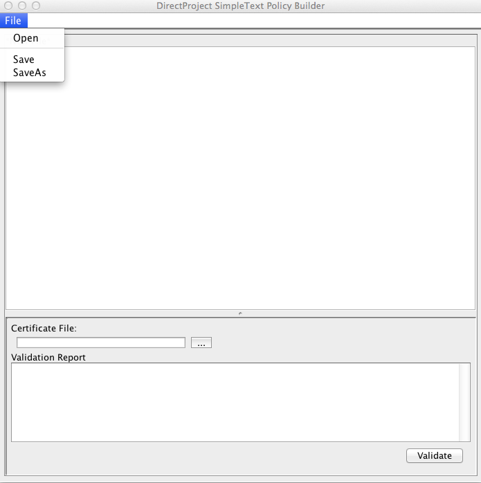
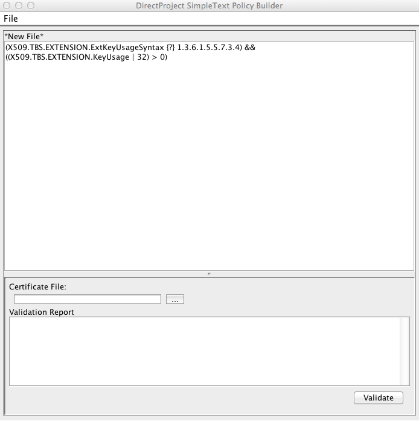
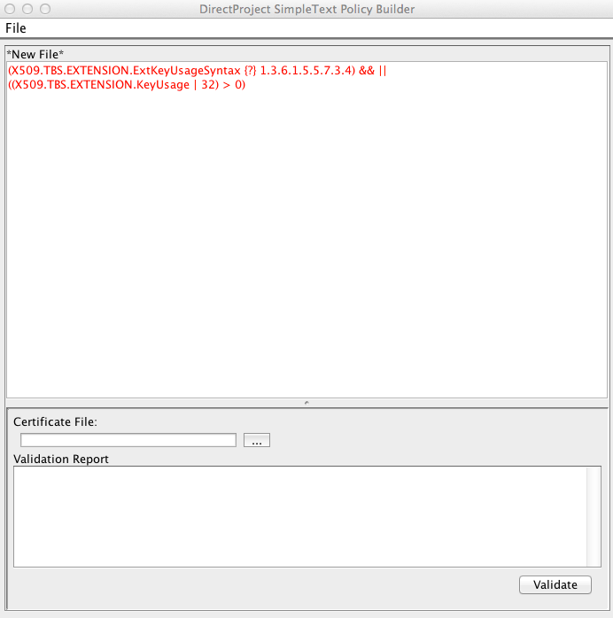
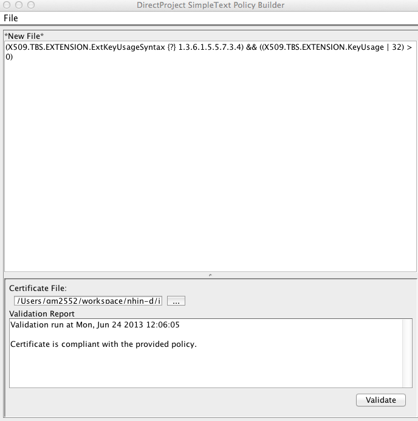
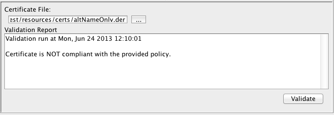
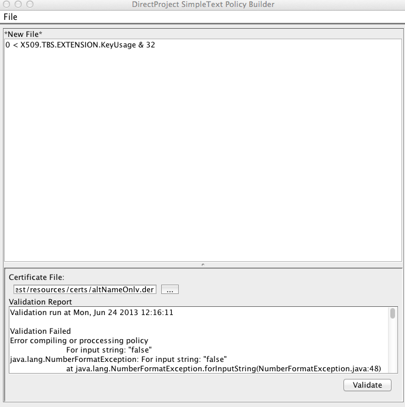

# Policy Builder

Policy Builder is a small desktop application for writing and testing policy definitions before you deploy them. It provides a text editor for composing a policy in the Simple Text lexicon and lets you validate that policy against any X.509 certificate to confirm the certificate is treated as you expect.

The tool ships with the reference implementation source tree. It is located in the `/java/direct-policy/tools` directory and is named `policyBuilder.sh` on Unix, Linux, and macOS, and `policyBuilder.bat` on Windows.

To run the tool, change to the `/java/direct-policy/tools` directory and run the launcher for your platform:

*Windows*

```
policyBuilder.bat
```

*Unix / Linux / macOS*

```
./policyBuilder.sh
```

## Editing a Policy

Write your policy in the text area in the upper portion of the window. You can either start a new policy from scratch or open an existing policy file with **File → Open**. Save your work with **File → Save** or **File → Save As**.



The tool validates your policy syntax in near real time. Valid syntax is shown in black text; invalid syntax is shown in red.

**Valid syntax**



**Invalid syntax**



## Testing a Policy

Once your policy is written, you can test it directly against an X.509 certificate. Click the ellipsis (`...`) button, browse to the certificate file you want to test against, and click **Open**. With the certificate loaded, click **Validate** to run the policy against it.

There are three possible outcomes.

**The certificate is in compliance**

The policy is syntactically valid and the certificate satisfies every condition in the policy.



**The certificate is not in compliance**

The policy is syntactically valid, but the certificate does not satisfy every condition in the policy.



**Runtime error**

The policy is syntactically correct but contains a logical error that surfaces only when the engine runs it. The tool reports the error along with a stack trace from the engine. The example below is syntactically correct but throws a runtime exception because it applies a logical AND to a non-boolean (integer) operand.


