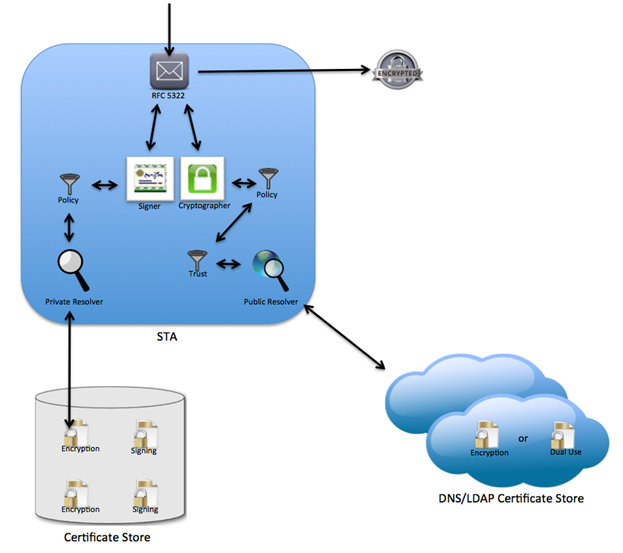
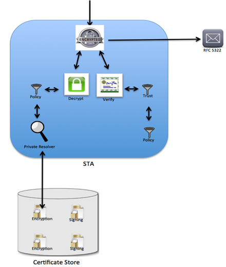

# Security and Trust (STA) Integration and Configuration

The Security and Trust Agent (STA) is the component of a Direct implementation that signs, encrypts, decrypts, and trust-validates messages. This guide explains how the agent applies policy filters and how to configure the policies it enforces.

## STA Integration

At strategic points in its processing, the Security and Trust Agent applies policy filters that remove discovered or otherwise encountered certificates that do not meet policy requirements. This lets a Direct implementation enforce policy decisions driven by regulatory or organizational needs while remaining backward compatible with the underlying transport specification.

When configured, policy filters are applied at the following points in the agent:

* **Private certificate resolution**
  * Invokes a policy decision on the use of certificates for decryption and message signing.
  * Allows dual-use certificates — or separate signing and encryption certificates — to be stored in the same certificate store. This preserves backward compatibility with existing certificate storage implementations.
* **Public certificate resolution**
  * Invokes a policy decision on the use of certificates for message encryption. These certificates are generally discovered dynamically over LDAP or DNS.
  * Allows dual-use certificates — or separate signing and encryption certificates — to be stored in the public certificate storage location. This preserves backward compatibility with existing discovery implementations.
* **Signature / trust validation**
  * Invokes a policy decision on the use of certificates extracted from the message signature.
  * Allows dual-use certificates — or separate signing and encryption certificates — to be encapsulated within the message signature. This preserves backward compatibility with existing message signing implementations.

The following diagrams illustrate the modular layout and message flow within the Security and Trust Agent, with policy filters shown at the points where they apply.

**Outbound Messages**



* Resolved private certificates are validated against a private resolver policy (if configured).
* Resolved public certificates are validated against a public resolver policy (if configured).
* Resolved public certificates are validated against a trust policy (if configured).

**Inbound Messages**



* Resolved private certificates are validated against a private resolver policy (if configured).
* Certificates extracted from the message signature are validated against a public trust policy (if configured).

## STA Configuration

STA configuration is built from two concepts: policies and policy groups. A policy is a single policy definition. A policy group is a collection of policies in which each policy is assigned a specific intercept point in the STA process, based on message direction and use. Policy groups are then assigned to domains. The constructs are organized hierarchically:

```
 + Domain
   |
   |
   - Policy Group
     |
     |
     |
     - Policy: message direction and use
     - Policy: message direction and use
     - Policy: message direction and use
```

Configuration is done through a command-line configuration management tool. Which tool you use depends on your deployment model — the interactive commands themselves (`IMPORTPOLICY`, `ADDPOLICYGROUP`, `ADDPOLICYTOGROUP`, `ADDPOLICYGROUPTODOMAIN`, etc.) are identical between the two and are matched case-insensitively; only the tool you launch differs:

* **Cloud Native deployment model:** Use the **Configuration Manager** tool. See [Configuration Manager Tool](https://directprojectjavari.github.io/direct-project-stock/cloud-native-deployment#configuration-manager-tool) in the stock deployment guide for where to download it and how to run it. Place the jar in its own directory and run it directly with `java -jar`:

  ```
  java -jar config-manager-9.0.0.jar
  ```

  With no arguments the interactive console is launched. A single command can also be run non-interactively by passing it directly on the command line:

  ```
  java -jar config-manager-9.0.0.jar IMPORTPOLICY "My Policy" ./MyPolicy.pol
  ```

  Configuration Manager connects to the Configuration Service's REST API. By default it uses `http://localhost:8082/`; override it with the `direct.config.service.url` property, either in an `application.yml` placed alongside the jar or as a command-line argument:

  ```
  java -jar config-manager-9.0.0.jar --direct.config.service.url=http://confserver:8082/
  ```

* **Legacy deployment model:** Use the **ConfigMgmtConsole** tool distributed with the legacy reference implementation assembly. Launch a command shell, navigate to the `<DIRECTHOME>`/ConfigMgmtConsole directory (or `ConfigTools/ConfigMgmtConsole/bin` in older assemblies), and run:

  ```
  ConfigMgmtConsole
  ```

  Use `./ConfigMgmtConsole` on Unix-based systems. The console connects to the Direct Project configuration service using the configuration service client module. By default it uses the url `http://localhost:8081/config-service/ConfigurationService`, but this can be overridden using the `configURL` command-line parameter:

  ```
  ConfigMgmtConsole configURL http://confserver/config-service/ConfigurationService
  ```

Either tool can take commands directly on the command line or run interactively. If no arguments or commands are passed on the command line (with the exception of the connection URL), the tool runs interactively. For a list of supported commands, type `help all` either as command-line arguments or when running interactively.

**Import Policy**

The first configuration step is to import your policy definition files. Import a policy with the `IMPORTPOLICY` command.

```
IMPORTPOLICY
Imports a policy from a file with an optional lexicon definition.
  policyName policyDefFile [lexicon]
	 policyName: Name of the policy.  Place the policy name in quotes ("") if there are spaces in the name.
	 policyDefFile: Fully qualified path and file name of the policy definition file.  Place the file name in quotes ("") if there are spaces in the path or name.
	 [lexicon]: Optional lexicon of the policy definition.  Default to SIMPLE_TEXT_V1 if not supplied.
```

When you import a policy, the tool parses the definition and validates its syntax against the supplied lexicon (or the default lexicon if none is given). If the definition is not valid, the tool displays an error message and does not import the policy.

**Add Group**

Before a policy can be assigned to a domain, it must be added to a policy group and given a usage. Create a group with the `ADDPOLICYGROUP` command.

```
ADDPOLICYGROUP
Adds policy group to the system
  groupName 
	 groupName: Name of the policy group.  Place the policy group name in quotes ("") if there are spaces in the name.
```

**Add Policy To Group**

A policy group is a collection of policies, and each policy in the group is assigned a usage that maps to an intercept point in the security and trust process. Add a policy to a group with the `ADDPOLICYTOGROUP` command.

```
ADDPOLICYTOGROUP
Adds an existing policy to a group with a provided usage.
  policyName groupNames policyUse incoming outgoing
	 policyName: Name of the policy to add to the group.  Place the policy name in quotes ("") if there are spaces in the name.
	 groupName: Name of the policy group to add the policy to.  Place the policy group name in quotes ("") if there are spaces in the name.
	 policyUse: Usage name of the policy in the group.  Must be one of the following values: TRUST, PRIVATE_RESOLVER, PUBLIC_RESOLVER.
	 incoming: Indicates if policy is used for incoming messages.  Must be one of the following values: true, false
	 outgoing: Indicates if policy is used for outgoing messages.  Must be one of the following values: true, false
```

The `policyUse` value, together with the `incoming` and `outgoing` parameters, maps the policy to the following points in the security and trust process:


| Policy Use | Direction | Intercept Point |
| --- | --- | --- |
| PUBLIC RESOLVER | Outgoing | Applied when the recipients' certificates are discovered via the public certificate resolver. |
| PUBLIC RESOLVER | Incoming | Applied when the sender's certificates are discovered via the public certificate resolver. This policy is generally unnecessary, because the sender's certificates are extracted from the message signature and filtered by the TRUST policy use. You may still want it alongside the TRUST filter to keep policies logically separate. |
| PRIVATE RESOLVER | Outgoing | Applied when the sender's certificates are discovered via the private certificate resolver. |
| PRIVATE RESOLVER | Incoming | Applied when the recipients' certificates are discovered via the private certificate resolver. |
| TRUST | Outgoing | Applied after the recipients' certificates are validated via certificate path chaining. This policy is generally unnecessary if the outgoing PUBLIC RESOLVER filter is set, but you may want it alongside the PUBLIC RESOLVER filter to keep policies logically separate. For example, the PUBLIC RESOLVER filter might check key usage while the TRUST filter checks policy OIDs. Keeping policies separate this way makes them easier to reuse across policy groups. |
| TRUST | Incoming | Applied after the sender's certificates are validated via certificate path chaining. |

**Add Group To Domain**

The default reference implementation policy resolver applies policies by the sender's domain for outgoing messages and by the recipient's domain for incoming messages. Associate a policy group with a domain using the **ADDPOLICYGROUPTODOMAIN** command.

```
ADDPOLICYGROUPTODOMAIN
Adds an existing policy group to an existing domain.
  groupName domainName
	 groupName: Name of the policy group to add to the domain.  Place the policy group name in quotes ("") if there are spaces in the name.
	 domainName: Name of the domain to add the group to.
```

**Additional Management Commands**

The tool supports additional management commands for deleting policies and groups and for dissociating domains, groups, and policies from one another. Run `help all` to see the complete list of commands.
